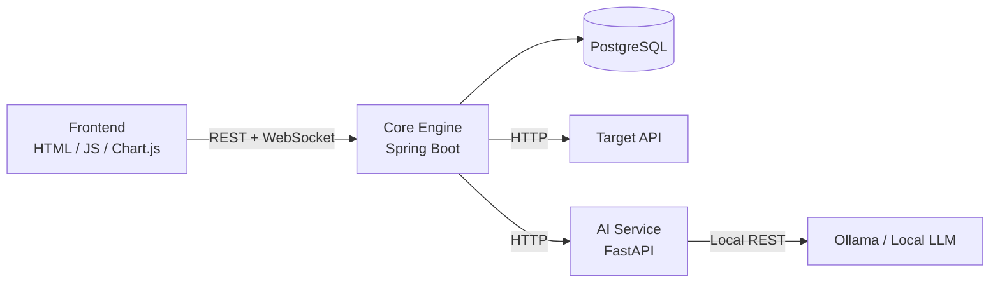

# ⚡ LoadSense

> Nền tảng kiểm thử hiệu năng Web API theo hướng **zero-code**: mô tả bài test bằng ngôn ngữ tự nhiên, chạy tải, theo dõi kết quả thời gian thực và nhận phân tích từ AI cục bộ.

**Trạng thái:** Khởi tạo dự án — tài liệu này là nguồn thống nhất cho phạm vi và cách triển khai.

## Mục tiêu

LoadSense giúp developer/tester tạo và chạy load test mà không phải tự viết kịch bản JMeter hay k6. Người dùng nhập yêu cầu, kiểm tra cấu hình được AI đề xuất, chạy test với các ràng buộc an toàn, rồi xem chỉ số và báo cáo chẩn đoán.

### Bốn luồng chính

| Luồng | Kết quả mong đợi |
| --- | --- |
| Prompt-to-Test | Prompt tự nhiên được chuyển thành cấu hình HTTP hợp lệ để người dùng xác nhận. |
| Smart Mock Data | JSON schema/mẫu được chuyển thành dữ liệu test hợp lệ. |
| Execution & Monitoring | Engine tạo tải có kiểm soát và phát latency, throughput, error rate theo thời gian thực. |
| AI Explainer | Số liệu đã tổng hợp được phân tích thành bottleneck và khuyến nghị dễ hành động. |

## Phạm vi MVP

| Ưu tiên | Hạng mục | Tiêu chí hoàn thành |
| --- | --- | --- |
| P0 | Tài khoản và xác thực JWT | Đăng ký/đăng nhập, bảo vệ API của người dùng. |
| P0 | Cấu hình test | Tạo/sửa/xác thực URL, HTTP method, headers, body, số người dùng và thời lượng. |
| P0 | Chạy/dừng test | Một test có vòng đời `PENDING → RUNNING → COMPLETED/FAILED/STOPPED`. |
| P0 | Dashboard realtime | Hiển thị throughput, latency p50/p95, error rate và trạng thái test. |
| P0 | Lịch sử và báo cáo | Lưu execution, số liệu tổng hợp và báo cáo AI. |
| P1 | Prompt-to-Test, mock data, AI explainer | Tích hợp sau khi contract API và engine cơ bản ổn định. |

Không nằm trong MVP: phân tán tải qua nhiều máy, scenario nhiều bước, tự động dừng theo dự báo, hoặc hỗ trợ cloud LLM. Đây là các hướng mở rộng sau khi luồng P0 hoạt động ổn định.

## Kiến trúc



- **Frontend** chỉ giao tiếp với Core Engine qua REST và WebSocket.
- **Core Engine** quản lý xác thực, cấu hình, vòng đời test, thu thập số liệu, lưu trữ và phát cập nhật realtime.
- **AI Service** là lớp riêng để Core Engine không phụ thuộc trực tiếp vào nhà cung cấp/model LLM.
- **Ollama** chạy cục bộ mặc định; prompt và log không phải gửi lên dịch vụ đám mây.

## Quyết định kỹ thuật ban đầu

| Thành phần | Lựa chọn |
| --- | --- |
| Core API | Java 17, Spring Boot 3, Spring Web, Spring Data JPA, Spring Security/JWT |
| Load engine | Java `HttpClient` hoặc `WebClient`, `ExecutorService`; giới hạn concurrency và timeout bắt buộc |
| Dữ liệu | PostgreSQL, Flyway cho migration |
| Realtime | Spring WebSocket (STOMP) |
| AI service | Python 3.10+, FastAPI, Pydantic |
| Local LLM | Ollama, ép output qua JSON Schema của Pydantic |
| Frontend | HTML/CSS/JavaScript, Chart.js, STOMP.js/SockJS |
| Hạ tầng dev | Docker Compose, `.env.example`, GitHub Actions sau khi có test |

## Cấu trúc repository

```text
Loadsense/
├── core-engine/             # Spring Boot API, load engine và WebSocket
├── ai-service/              # FastAPI, adapters LLM và schema AI
├── frontend/                # Giao diện dashboard
├── infra/                   # Docker Compose, cấu hình local/dev
├── docs/                    # ADR, OpenAPI export và tài liệu bổ sung (khi cần)
├── .env.example             # Chỉ tên biến, không chứa bí mật
└── README.md                # Nguồn tổng quan chính của dự án
```

Các thư mục trên là cấu trúc mục tiêu; chúng sẽ được tạo theo từng milestone, không phải mã nguồn đã hoàn thiện.

## Mô hình dữ liệu cốt lõi

- `User`: tài khoản và thông tin xác thực.
- `TestConfig`: cấu hình có thể tái sử dụng, gồm target URL, HTTP method, request body, số virtual users và duration.
- `MockDataSet`: schema/mẫu và các payload sinh ra.
- `TestExecution`: một lần chạy của `TestConfig`, trạng thái, mốc thời gian và số liệu tổng hợp.
- `TestMetric`: mẫu đo theo thời gian; khi tải lớn cần aggregate/batch insert thay vì ghi từng request.
- `TestReport`: summary, bottleneck và recommendation từ AI.

Quan hệ chính: một `User` sở hữu nhiều `TestConfig`; một `TestConfig` có nhiều `TestExecution` và `MockDataSet`; một execution có nhiều metrics và tối đa một report.

## Hợp đồng tích hợp

Trước khi phát triển song song, nhóm thống nhất các contract sau và ghi chúng vào OpenAPI/Pydantic schema:

1. `POST /api/test-configs` — tạo hoặc cập nhật cấu hình đã được người dùng duyệt.
2. `POST /api/test-configs/{id}/executions` — bắt đầu execution.
3. `POST /api/executions/{id}/stop` — dừng có kiểm soát, idempotent.
4. `GET /api/executions/{id}` và WebSocket topic execution — trạng thái cùng metrics đã aggregate.
5. AI Service: `POST /parse-prompt`, `POST /generate-mockdata`, `POST /analyze-log` — input/output có schema rõ ràng.

AI chỉ đề xuất dữ liệu. Core Engine phải validate URL, phương thức, giới hạn tải và mọi JSON do AI trả về trước khi lưu hoặc chạy.

## An toàn khi chạy load test

LoadSense chỉ được dùng với API mà người dùng có quyền kiểm thử. MVP phải có các biện pháp sau:

- Cảnh báo rõ ràng và yêu cầu xác nhận target trước khi chạy.
- Allowlist/denylist hoặc chế độ local-only cho môi trường demo.
- Giới hạn số virtual users, thời lượng, request rate, timeout và body size.
- Không lưu token, header nhạy cảm hoặc payload bí mật trong log/report thô.
- Có nút dừng test và cơ chế cleanup tài nguyên đáng tin cậy.

## Lộ trình xây dựng

1. **Foundation:** tạo skeleton monorepo, Docker Compose (PostgreSQL), migration, health check, `.env.example`, CI lint/test.
2. **Core flow:** auth, CRUD `TestConfig`, execution một endpoint, stop/cancel và persistence.
3. **Observability:** aggregate metrics, WebSocket và dashboard lịch sử.
4. **AI integration:** FastAPI schemas, Ollama adapter, mock response tests; lần lượt bật prompt parsing, mock data và explainer.
5. **Hardening:** validation target, rate limit, test đa luồng, audit/log redaction và demo script.

## Môi trường phát triển dự kiến

- JDK 17+ và Maven 3.9+
- Python 3.10+
- Docker và Docker Compose
- Node.js LTS (chỉ khi dùng dev server/tooling frontend)
- Ollama cùng một model đã thống nhất cho nhóm

Biến môi trường dự kiến:

```env
DATABASE_URL=jdbc:postgresql://localhost:5432/loadsense
DATABASE_USERNAME=loadsense
DATABASE_PASSWORD=change-me
AI_SERVICE_URL=http://localhost:8000
OLLAMA_HOST=http://localhost:11434
OLLAMA_MODEL=<model-da-thong-nhat>
JWT_SECRET=<local-development-secret>
```

Không commit `.env`, secret, database dump hay dữ liệu test nhạy cảm. Chỉ commit `.env.example` với giá trị mẫu an toàn.

## Quy ước làm việc

- Nhánh chính: `main`; phát triển trên `feature/<ten-ngan-gon>`.
- Mỗi pull request mô tả phạm vi, cách kiểm thử và thay đổi contract nếu có.
- Không merge khi chưa có test phù hợp cho logic engine/service và review của ít nhất một thành viên khác.
- API thay đổi phải cập nhật OpenAPI; AI contract thay đổi phải cập nhật Pydantic schema và mock tests cùng lúc.
- Commit nhỏ, có nghĩa: `feat:`, `fix:`, `docs:`, `test:`, `chore:`.

## Phân công gợi ý cho nhóm 3 người

| Thành viên | Trách nhiệm chính |
| --- | --- |
| 1 | Core Engine: entity, repository, service, load engine, WebSocket và security. |
| 2 | AI Service: FastAPI, schema, Ollama adapter, đánh giá model và contract AI. |
| 3 | Frontend: luồng cấu hình, dashboard, history và tích hợp REST/WebSocket. |

Mọi người cùng sở hữu: API contract, Docker Compose, test end-to-end, security review và tài liệu này.

## Bước tiếp theo

1. Xác nhận PostgreSQL và model Ollama dùng cho demo.
2. Tạo skeleton theo cấu trúc repository, Docker Compose và pipeline kiểm thử tối thiểu.
3. Chốt OpenAPI cho execution trước khi làm frontend/AI song song.

---

Repository: [Baronphviet/Loadsense](https://github.com/Baronphviet/Loadsense)
