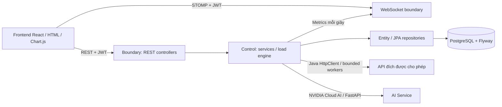

# ⚡ LoadSense

> **Tích hợp AI bên thứ ba (NVIDIA Cloud AI / OpenAI-compatible):** LoadSense sử dụng **API LLM bên thứ ba tương thích chuẩn OpenAI** (mặc định **NVIDIA Cloud AI — NVIDIA Nemotron**, hỗ trợ cấu hình trung lập qua `LLM_API_KEY`, `LLM_BASE_URL`, `LLM_MODEL`, `LLM_TIMEOUT_SECONDS` hoặc fallback `NVIDIA_*`) cho Prompt-to-Test, Smart Mock-Data và AI Explainer (bao gồm Auto AI Explainer và phân tích điểm nghẽn/khuyến nghị). Phương án Local LLM / Ollama đã được loại bỏ theo quyết định triển khai hiện tại.

### Bật AI Service

1. Tạo API key trên [NVIDIA Build](https://build.nvidia.com/nvidia/nemotron-3-ultra-550b-a55b) (hoặc nhà cung cấp OpenAI-compatible bất kỳ như OpenAI, OpenRouter, Groq...).
2. Sao chép `.env.example` thành `.env`, đặt `NVIDIA_API_KEY` (hoặc `LLM_API_KEY`, `LLM_BASE_URL`, `LLM_MODEL`) và một giá trị ngẫu nhiên riêng cho `AI_SERVICE_TOKEN`. Không commit các giá trị này.
3. Khởi chạy `docker compose --env-file .env -f infra/docker-compose.yml --profile ai up --build -d`.
4. Trong AI Workspace, nhập prompt để tạo cấu hình và duyệt trước khi lưu. Với cấu hình có body, mở **Dữ liệu** để nhập schema, sinh payload, duyệt và lưu. Sau một lần chạy, mở báo cáo và bấm **Phân tích bằng AI**.

Vào **Tài liệu** trong ứng dụng để làm bài test đầu tiên và tra cứu các thuật ngữ. Các mục trợ giúp trong biểu mẫu và báo cáo mở thẳng phần liên quan.

AI Explainer gửi thông số tải, chỉ số tổng hợp và tối đa 60 mẫu đo tới AI Service; không gửi URL, header, body hoặc token người dùng. Quan sát và số liệu trong báo cáo được tính từ kết quả đo; gợi ý của model được đánh dấu là giả thuyết cần kiểm chứng. Khi có dưới 10 request hoặc thiếu ba mốc thời gian và tổng request khác nhau, hệ thống trả tóm tắt từ số liệu mà không gọi model để suy luận xu hướng. Các phân tích đã lưu trước đó vẫn đọc được.

Prompt và schema nhập vào được gửi tới NVIDIA: không nhập token, mật khẩu hoặc thông tin nhạy cảm. AI Explainer chỉ gửi số liệu tổng hợp. Core kiểm tra payload theo schema trước khi lưu, kể cả khi AI Service tắt. Các lỗi dịch vụ và giới hạn lượt gọi được hiển thị để thử lại. NVIDIA model, URL và timeout có thể cấu hình trong `.env`; AI Service cung cấp ranh giới adapter để tích hợp model local sau này.

Nền tảng kiểm thử hiệu năng Web API theo mô hình **Zero-Code**, kiến trúc **Boundary – Control – Entity (BCE)**. Người dùng cấu hình request bằng biểu mẫu, chạy engine đa luồng, theo dõi Chart.js theo thời gian thực và xem lại lịch sử/báo cáo.

Triển khai bám theo đề cương *Phát triển Hệ thống kiểm thử hiệu năng Web API tích hợp AI*, nhóm 6. **NVIDIA Cloud AI** là nhà cung cấp AI chính thức (Local LLM/Ollama đã bị loại bỏ theo chỉ đạo triển khai).

## Mục tiêu và phạm vi theo đề cương

Đề cương hướng tới nền tảng LoadSense với bốn luồng nghiệp vụ cốt lõi:

| Luồng trong đề cương | Mục tiêu cuối cùng | Trạng thái hiện tại |
| --- | --- | --- |
| **Prompt-to-Test** | Chuyển yêu cầu ngôn ngữ tự nhiên thành cấu hình HTTP để người dùng duyệt | Đã triển khai với NVIDIA Cloud AI, JSON Schema output và bước duyệt/sửa trước khi lưu |
| **Smart Mock-Data** | Sinh dữ liệu giả lập hợp lệ từ JSON Schema/mẫu | Đã triển khai sinh payload qua NVIDIA Cloud AI, kiểm định JSON Schema ở Core và xoay vòng payload khi chạy |
| **Execution & Monitoring** | Điều phối đa luồng, đo và giám sát hiệu năng realtime, dừng test thủ công | Đã triển khai engine đa luồng, `errorBreakdown`, Early Anomaly Detection (tùy chọn tự động dừng), STOMP + polling dự phòng và `scripts/benchmark.mjs` |
| **AI Explainer** | Phân tích số liệu/log sau test, xác định điểm nghẽn và đề xuất khắc phục | Đã triển khai Auto AI Explainer (tự động chạy nền khi bật trong Cài đặt) và phân tích thủ công qua NVIDIA Cloud AI |

Đăng ký/đăng nhập, quản lý cấu hình, dữ liệu, cài đặt người dùng (`/api/settings`), lịch sử và báo cáo là các UC hỗ trợ bốn luồng trên.

## Tiến độ theo Use Case

Mã UC dưới đây là mã theo dõi của dự án, không phải số thứ tự có sẵn trong PDF. `UC-01` đến `UC-05` khớp với đặc tả hiện có trong [tài liệu kiến trúc](docs/architecture.md); nhóm `UC-AI-*` tách rõ các luồng AI để theo dõi phần chưa triển khai.

| Mã UC | Use Case | Điểm đã làm được | Phần còn thiếu theo mục tiêu đề cương |
| --- | --- | --- | --- |
| UC-01 | Đăng ký / đăng nhập & Cài đặt | Tạo tài khoản, BCrypt, JWT 24 giờ, chống brute-force (`429 LOGIN_RATE_LIMITED` sau 5 lần sai/60s), bảo vệ API/STOMP và `GET/PUT /api/settings` | Đã hoàn thành |
| UC-02 | Tạo và quản lý cấu hình test | Biểu mẫu URL/method/headers/body/VUs/duration/RPS/timeout, `loadProfile` (`CONSTANT`/`RAMP_UP`/`STEP_STRESS`/`SPIKE`), Scenario Chaining (0–3 bước `{{var}}`) | Đã hoàn thành |
| UC-03 | Quản lý dữ liệu mock & kiểm định schema | Lưu mảng JSON object, lưu schema tham chiếu, kiểm định payload theo JSON Schema, chọn dataset và xoay vòng payload | Đã hoàn thành |
| UC-04 | Execution & Monitoring | Engine đa luồng, `p99`/`max`/`intervalP95Ms`/`intervalErrorRate`, `errorBreakdown`, Early Anomaly Detection theo nhịp, `stopReason`, STOMP + polling | Đã hoàn thành & benchmark 50/100/300 VUs |
| UC-05 | Xem lịch sử / báo cáo | Lưu execution/metrics/report, tìm và lọc 100 lần gần nhất, so sánh **Baseline vs Current**, xuất CSV đầy đủ cột mới | Đã hoàn thành |
| UC-06 | Auto Test Suite (kiểu TestSprite) | Deep BFS Crawler 3 tầng (`50/100/200 UC`), Form ↔ YAML, **Agent Action View** trực quan (zoom/pan, duyệt nhánh theo nhịp `1–4s`, Lightbox Web), chuyển sang Stress Lab | Đã hoàn thành |
| UC-AI-01 | Prompt-to-Test | AI Workspace, Pydantic input/output, gọi API LLM bên thứ ba ép JSON Schema, giới hạn 10 lượt/phút/user, duyệt trước khi lưu | Đã hoàn thành |
| UC-AI-02 | Smart Mock-Data | Sinh payload từ JSON Schema qua API LLM bên thứ ba, kiểm định lại ở Core, xem trước và lưu dataset | Đã hoàn thành |
| UC-AI-03 | AI Explainer & Suite AI Summary | Phân tích số liệu hiệu năng (`bottlenecks`, `recommendations`, `findings`), Auto AI Explainer nền, và **AI Tóm tắt Preview · Error · Cause · Fix** cho từng Test Case | Đã hoàn thành |

### UC-01 — Đăng ký / đăng nhập

- [x] Đăng ký username, kiểm tra trùng và lưu mật khẩu bằng BCrypt.
- [x] Đăng nhập, cấp JWT HS256 có thời hạn 24 giờ; giao diện giữ session và hỗ trợ đăng xuất.
- [x] Bảo vệ REST API và kiểm tra quyền sở hữu cấu hình, dataset, execution, metrics, report và CSV.
- [x] Xác thực STOMP CONNECT và kiểm tra owner khi SUBSCRIBE execution.

**Đã kiểm chứng:** đăng ký/đăng nhập đúng–sai, username trùng, API thiếu JWT, truy cập dữ liệu và subscription của tài khoản khác; luồng đăng xuất/đăng nhập trên trình duyệt.

### UC-02 — Tạo và quản lý cấu hình test

- [x] Tạo/xem/sửa/xóa cấu hình bằng biểu mẫu, không cần viết script JMeter/k6.
- [x] Cấu hình URL, HTTP method, headers, body, virtual users, duration, giới hạn RPS, timeout, **kiểu tải (`loadProfile`: `CONSTANT` / `RAMP_UP` / `STEP_STRESS` / `SPIKE`)**, `rampUpSeconds` và **Scenario Chaining tối giản (0–3 bước trích xuất biến JSON `{{var}}`)**.
- [x] Validate DTO, exact host allowlist (bao gồm multi-host trong chain và chặn `{{...}}` ở scheme/authority), URI, header và kích thước body ở backend.
- [x] Tái sử dụng cấu hình; giữ snapshot riêng cho mỗi execution để lịch sử không đổi khi sửa cấu hình nguồn.
- [x] Chặn xóa cấu hình đã có execution để bảo toàn lịch sử.

**Giới hạn:** đây là cách tạo cấu hình thủ công. Tạo bằng ngôn ngữ tự nhiên được theo dõi riêng trong UC-AI-01.

### UC-03 — Quản lý dữ liệu mock thủ công

- [x] Nhập/lưu bộ dữ liệu gồm 1–1000 JSON object, thuộc một cấu hình có request body.
- [x] Lưu JSON Schema tham chiếu dưới dạng JSON object.
- [x] Chọn dataset khi bắt đầu test; engine xoay vòng payload giữa các request.
- [x] Kiểm tra định dạng JSON, số lượng/kích thước payload và quyền sở hữu dataset.
- [x] Kiểm định từng payload theo JSON Schema trước khi lưu/chạy.

### UC-04 — Execution & Monitoring

- [x] Xác nhận quyền kiểm thử target trước khi bắt đầu; kiểm tra cấu hình và giới hạn số test đồng thời.
- [x] Điều phối `ExecutorService`, bounded worker pool, timeout/deadline và giới hạn RPS dùng chung giữa các VU.
- [x] Quản lý vòng đời `PENDING → RUNNING → COMPLETED / FAILED / STOPPED`.
- [x] Dừng idempotent, interrupt/cleanup worker; đánh dấu execution gián đoạn là FAILED khi engine khởi động lại.
- [x] Tổng hợp request count, throughput, average latency, `p50`/`p95`/`p99`/`max`, `intervalP95Ms`, `intervalErrorRate`, error rate, `errorBreakdown` (`http4xx`, `http429`, `http5xx`, `timeout`, `network`), `stopReason` và active users.
- [x] **Early Anomaly Detection:** cảnh báo sớm dựa trên chỉ số nhịp 1 giây (`intervalErrorRate`, `intervalP95Ms`) theo ngưỡng `/api/settings`, kèm tùy chọn tự động dừng bảo vệ (`autoStopOnAnomaly` sau 3 chu kỳ, `stopReason = ANOMALY`).
- [x] Lưu metric khoảng mỗi giây; dashboard Chart.js (`p50`, `p95`, `p99`, `Interval p95`, `Error %`) nhận private STOMP event, có REST incremental polling (`afterElapsed`) 2 giây dự phòng.
- [x] Kiểm thử chức năng với 300 VUs, rate cap, timeout/lỗi HTTP và dừng test.
- [x] Script benchmark `scripts/benchmark.mjs` đo độ ổn định 50/100/300 VUs và độ trễ cập nhật realtime (`receivedAt - sampleTime`) theo SLA `< 1–2s`.

### UC-05 — Xem lịch sử và báo cáo

- [x] Lưu các lần chạy và mẫu đo trong PostgreSQL; xem lại sau reload.
- [x] Hiển thị 100 execution gần nhất thuộc tài khoản; tìm theo tên/URL và lọc trạng thái.
- [x] Xem chi tiết trạng thái, snapshot metadata, biểu đồ và số liệu tổng hợp.
- [x] Tạo report khi execution kết thúc; xuất CSV chứa số liệu đo.
### UC-AI-01 — Prompt-to-Test

- [x] AI Workspace với ô nhập prompt và gọi NVIDIA Cloud AI qua Core `/api/ai/parse-prompt` và FastAPI `/parse-prompt`.
- [x] Ép output model theo JSON Schema (`response_format`), xử lý lỗi dịch vụ/giới hạn lượt gọi (`AI_AUTH_ERROR` map về 503).
- [x] Hiển thị cấu hình đề xuất và warnings cho người dùng sửa/duyệt; Core revalidate rồi lưu vào `TestConfig` trước khi chạy.

### UC-AI-02 — Smart Mock-Data

- [x] Core `/api/ai/generate-mockdata` và FastAPI `/generate-mockdata` sinh payload từ JSON Schema qua NVIDIA Cloud AI.
- [x] Kiểm định từng payload theo JSON Schema ở Core trước khi lưu vào `MockDataSet`.
- [x] Cho phép xem trước, duyệt và chọn bộ dữ liệu khi chạy execution (`mockDataSetId` được lưu vết trên `TestExecution`).

### UC-AI-03 — AI Explainer & Auto AI Explainer

- [x] Core `/api/ai/analyze-log` và FastAPI `/analyze-log` phân tích số liệu tổng hợp, `errorBreakdown`, `anomalyWarning` và tối đa 60 mẫu đo qua NVIDIA Cloud AI.
- [x] Hỗ trợ **Auto AI Explainer**: tự động chạy nền sau khi execution kết thúc (cấu hình mặc định trong `/api/settings` hoặc ghi đè trên mỗi lần chạy qua `autoAiAnalyze`), cập nhật trạng thái `PENDING → COMPLETED / INSUFFICIENT_DATA / FAILED` và phát sự kiện STOMP.
- [x] Lưu `ai_model`, `ai_analyzed_at`, tóm tắt, bottlenecks và recommendations gắn với `TestReport`.

## Kiến trúc và nền tảng đã triển khai

| Hạng mục theo PDF | Hiện trạng | Ghi chú |
| --- | --- | --- |
| Kiến trúc BCE; các gói controller/service/client/repository/entity/dto/config | Đã tổ chức mã nguồn và tài liệu kiến trúc | Đã tích hợp `AiClient` và cập nhật đặc tả trong `docs/architecture.md` |
| Use Case, lớp Entity và sơ đồ gói | Đã có sơ đồ và đặc tả trong `docs/architecture.md` | Bao gồm `V5` và `V6` migration cho settings, `load_profile`, `steps_json`, `p99`/`max`/`interval_*`, `stop_reason` |
| Sáu entity chính + TestSuite | Đã có bảng, FK/index, JPA và Flyway V1–V8 trên PostgreSQL | Đã bổ sung `V7__auto_test_suites.sql` và `V8__fix_delete_constraints.sql` |
| Core Engine Java / Spring Boot | REST, JWT, brute-force lock, AI rate limit, load engine, chaining, Early Anomaly, Auto AI Explainer, Auto Test Suite, STOMP | Hỗ trợ `GET/PUT /api/settings`, `afterElapsed`, `PacedRateLimiter` 4 profiles, `/api/suites/**` |
| Frontend HTML/JS + Chart.js | React; auth, Auto Test Suite (`AgentActionGraph` + Lightbox + Drawer AI), builder (4 profile + chaining), Cài đặt, Chart `Interval p95`/`p99`, History ComparePanel, AI Workspace | Hiển thị đầy đủ hoạt ảnh chờ động (`activity-loader-card`), `previewSummary`, `bottlenecks`, `recommendations`, `findings` |
| AI Service Python / FastAPI / Pydantic | Adapter trung lập (`LLM_*` / `NVIDIA_*`), retry/backoff `429/502/503/504`, `detect_bottlenecks_and_recommendations`, `/explain-suite-case` | Local LLM/Ollama đã bị loại bỏ khỏi phạm vi |
| Triển khai cục bộ | Docker Compose cho PostgreSQL/Core/frontend, nginx proxy; profile `ai` cho AI Service | Chạy được toàn bộ luồng chức năng và AI khi có `LLM_API_KEY` hoặc `NVIDIA_API_KEY` |
| Kiểm thử, đánh giá và benchmark | Unit/integration tests (31 Core, 25 AI, 4 Frontend), Black-box matrix và `scripts/benchmark.mjs` | Đã benchmark thực nghiệm 50/100/300 VUs, STOMP `p95UpdateMs = 16–27 ms` |

**Hướng mở rộng tiếp theo nếu cần:** Distributed workers, Scenario Chaining có rẽ nhánh/vòng lặp điều kiện, phân trang lịch sử đầy đủ sau 100 execution và retention dữ liệu. Local LLM/Ollama không còn nằm trong kế hoạch triển khai.

## Kết quả đã kiểm chứng

Theo [báo cáo kiểm chứng](docs/validation.md):

- **PostgreSQL 15 + Flyway V1–V6:** Đã kiểm chứng trực tiếp chạy `core-0.0.1-SNAPSHOT.jar` với `postgres:15-alpine` (`ddl-auto=validate`), 6/6 migration `V1`–`V6` thành công (`success = t`).
- **Core Engine (31/31 tests pass):** Unit & integration tests (`CoreFlowTest`: 22, `MetricAccumulatorTest`: 5, `AiAnalysisInputTest`: 2, `AiClientTest`: 2).
- **AI Service (25/25 tests pass):** `unittest` kiểm tra contract, `detect_bottlenecks_and_recommendations`, `/explain-suite-case`, retry/backoff và adapter `LLM_*`/`NVIDIA_*`.
- **Frontend:** `node --test frontend/src/reportModel.test.js` (4/4 pass), `pnpm --dir frontend lint` (0 errors), `pnpm --dir frontend build` (65 modules).
- **Benchmark thực nghiệm 50 / 100 / 300 VUs (`scripts/benchmark.mjs`, target echo 15ms độc lập, `RPS_LIMIT=500`, SLA `< 2000 ms`):**
  - **50 VUs:** `4.955 req`, lỗi `0%`, `495,36 req/s`, `p50=16 ms`, `p95=17 ms`, `p99=43 ms`, STOMP `avg=17 ms`, `p95=27 ms`.
  - **100 VUs:** `4.988 req`, lỗi `0,02%`, `498,74 req/s`, `p50=16 ms`, `p95=16 ms`, `p99=17 ms`, STOMP `avg=13 ms`, `p95=19 ms`.
  - **300 VUs:** `4.992 req`, lỗi `0,06%`, `499,13 req/s`, `p50=15 ms`, `p95=16 ms`, `p99=16 ms`, STOMP `avg=11 ms`, `p95=16 ms`.
- **Browser E2E (baseline 14/10/2026):** Playwright đã pass toàn bộ luồng cơ bản ở mốc baseline (chưa chạy lại trên UI đợt V6).

## Chạy bằng Docker Compose

Yêu cầu Docker + Compose. Các dependencies/images cần tải trong lần build đầu; khi đã chuẩn bị, luồng kiểm thử không dùng dịch vụ Internet hoặc AI cloud.

```bash
cp .env.example .env
docker compose --env-file .env -f infra/docker-compose.yml up --build -d
```

- Giao diện: http://localhost:3000
- Core health: http://localhost:8080/api/health
- PostgreSQL: localhost:5432, database `loadsense`
- Tài khoản: tự đăng ký trên giao diện; không có tài khoản mặc định.
- Demo: tạo cấu hình `GET http://core-engine:8080/demo/echo?delayMs=30`, 20 VUs, 10 giây, 100 RPS. Host `core-engine` được engine phân giải trong mạng Docker.
- Có thể dùng `http://localhost:8080/demo/echo` làm target vì demo chạy trong cùng Core Engine. Endpoint demo chấp nhận `delayMs=0..1000`, `status=200|201|400|500`.

`.env.example` chứa giá trị phục vụ phát triển. Trước khi dùng ngoài môi trường demo, đặt JWT secret riêng (tối thiểu 32 byte), mật khẩu DB riêng, allowlist host chính xác, origins chính xác và `DEMO_ENABLED=false`.

```bash
# Chạy kèm AI Service (NVIDIA Cloud AI):
docker compose --env-file .env -f infra/docker-compose.yml --profile ai up --build -d ai-service
# Xem logs / dừng, giữ dữ liệu:
docker compose --env-file .env -f infra/docker-compose.yml logs -f core-engine
docker compose --env-file .env -f infra/docker-compose.yml down
```

Database được giữ trong named volume. Không dùng `down -v` nếu cần giữ lịch sử.

## Phát triển cục bộ

Yêu cầu **JDK 17**, Maven 3.9+, Node 20/22 LTS, pnpm 10.17.1; Python 3.10+ chỉ cần khi làm khung AI.

```bash
cp .env.example .env
docker compose --env-file .env -f infra/docker-compose.yml up -d postgres
# Trong một terminal (xuất biến môi trường từ .env nếu đã thay đổi):
mvn -f core-engine/pom.xml spring-boot:run
# Trong terminal khác:
cd frontend
corepack enable
pnpm install --frozen-lockfile
pnpm dev
```

Giao diện dev: http://localhost:5173. Vite proxy `/api` và `/ws` về localhost:8080. Có thể đặt `VITE_API_BASE_URL` cho deployment khác origin; phải thêm origin tương ứng vào `ALLOWED_ORIGINS`.

**Lưu ý network:** target URL được gọi từ Core Engine, không từ trình duyệt. `localhost` trong container là chính container; Với host công khai mới, xác nhận quyền kiểm thử trên biểu mẫu để sử dụng lại mà không cần sửa `.env`. Host nội bộ vẫn cần được cấu hình trong `ALLOWED_TARGET_HOSTS`. Không có wildcard host, không tự động theo redirect.

```bash
# FastAPI skeleton tùy chọn:
cd ai-service
python -m venv .venv
source .venv/bin/activate
pip install -r requirements.txt
uvicorn app.main:app --reload
# API schemas: http://localhost:8000/docs
```

## Kiểm thử & Benchmark

```bash
mvn -B -f core-engine/pom.xml test
node --test frontend/src/reportModel.test.js
pnpm --dir frontend lint
pnpm --dir frontend build
cd ai-service && python3 -m unittest discover -s tests -v
```

Chạy benchmark tải (50, 100, 300 VUs) và đo SLA độ trễ cập nhật STOMP (`receivedAt - sampleTime`) khi Core Engine đang chạy:

```bash
BASE_URL=http://localhost:8080 node scripts/benchmark.mjs
```

Backend tests dùng H2 riêng, HTTP target nội bộ và WebSocket thật; kiểm tra JWT/ownership, validation, snapshot, chạy/dừng, lỗi/timeout, redirect, dữ liệu mock, admission limit, 300 VUs và rate limit dùng chung. H2 tests không thay thế việc xác minh Flyway trên PostgreSQL; có thể chạy suite trực tiếp với PostgreSQL:

```bash
mvn -B -f core-engine/pom.xml test \
  -Dspring.datasource.url=jdbc:postgresql://localhost:5432/loadsense_test \
  -Dspring.datasource.username=loadsense \
  -Dspring.datasource.password=change-me \
  -Dspring.jpa.hibernate.ddl-auto=validate \
  -Dspring.flyway.enabled=true
```

Dùng database kiểm thử riêng, không dùng database chứa dữ liệu cần giữ.

Kiểm tra UI bằng Playwright khi Core/Frontend đang chạy (tạo tài khoản/dữ liệu thử, nên dùng DB thử nghiệm):

```bash
cd frontend
pnpm exec playwright install chromium
pnpm test:e2e
# Với Compose, đặt BASE_URL=http://localhost:3000 pnpm test:e2e
```

Có thể đặt `CHROME_EXECUTABLE` để dùng Chrome đã cài. Script kiểm tra đăng ký, cấu hình, xác nhận target, STOMP/biểu đồ, báo cáo/CSV, reload lịch sử, dừng test, AI deferred, viewport mobile và đăng xuất/đăng nhập. Ảnh QA được ghi vào `output/screenshots/` (không đưa vào Git).

## Kiến trúc và tài liệu



React chỉ tổ chức HTML/JavaScript và quản lý state; Chart.js đảm nhiệm biểu đồ, Spring Boot thực hiện nghiệp vụ và load engine. Giữ stack của skeleton hiện có.

- [Thiết kế kiến trúc BCE, UML và nghiệp vụ](docs/architecture.md)
- [Hợp đồng REST/WebSocket](docs/api.md), [OpenAPI 3.0](docs/openapi.json)
- [Đối chiếu đề cương và giới hạn hiện tại](docs/requirements.md)
- [Kết quả kiểm thử triển khai](docs/validation.md)

```text
core-engine/src/main/java/com/loadsense/core/
  controller/   # Boundary: REST DTO, validation, lỗi (bao gồm /api/settings)
  config/       # Security, CORS, STOMP authentication/authorization
  service/      # Control: auth, configs, execution persistence, load scheduling, metrics, anomaly detection
  client/       # HTTP adapter cho target; AiClient gọi FastAPI AI Service
  repository/   # Truy vấn theo chủ sở hữu, persistence
  entity/       # UserAccount, TestConfig, MockDataSet, TestExecution, TestMetric, TestReport
  dto/          # Input/output contract tách khỏi credential/snapshot
frontend/src/   # Auth, builder, settings modal, charts, dashboard, history, AI Workspace
ai-service/app/ # FastAPI + Pydantic + NVIDIA Cloud AI client
infra/          # Docker Compose, healthchecks
scripts/        # browser-smoke.mjs (E2E) và benchmark.mjs (SLA & load benchmark)
```

Mỗi lần chạy giữ snapshot riêng. Chỉ một điểm đo aggregate mỗi giây được ghi DB; không ghi từng request hoặc raw response/header/body vào log/report. Engine dừng các test `PENDING/RUNNING` còn sót khi khởi động lại bằng trạng thái `FAILED`, kèm báo cáo gián đoạn.

Giới hạn hiện tại: 1–300 VUs/test, 1–600 giây, 1–500 RPS/test, 100–30.000 ms timeout, 64 KiB body, 32 headers/16 KiB, mặc định 2 test đồng thời. Giới hạn được kiểm tra ở backend. Chỉ chạy kiểm thử trên API có quyền; giới hạn RPS là upper bound, không đảm bảo đạt tốc độ đó.
