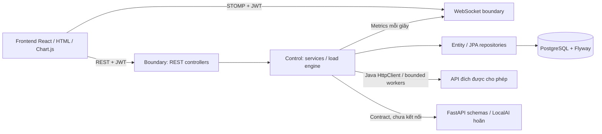

# ⚡ LoadSense

Nền tảng kiểm thử hiệu năng Web API theo mô hình **Zero-Code**, kiến trúc **Boundary – Control – Entity (BCE)**. Người dùng cấu hình request bằng biểu mẫu, chạy engine đa luồng, theo dõi Chart.js theo thời gian thực và xem lại lịch sử/báo cáo.

Triển khai bám theo đề cương *Phát triển Hệ thống kiểm thử hiệu năng Web API tích hợp AI*, nhóm 6. **LocalAI/Ollama được hoãn theo phạm vi hiện tại**: có giao diện và schema tích hợp; không gọi model, không giả lập kết quả AI.

## Mục tiêu và phạm vi theo đề cương

Đề cương hướng tới nền tảng LoadSense với bốn luồng nghiệp vụ cốt lõi:

| Luồng trong đề cương | Mục tiêu cuối cùng | Trạng thái hiện tại |
| --- | --- | --- |
| **Prompt-to-Test** | Chuyển yêu cầu ngôn ngữ tự nhiên thành cấu hình HTTP để người dùng duyệt | Có AI Workspace và contract; chưa phân tích prompt. Tạo cấu hình thủ công đã hoạt động |
| **Smart Mock-Data** | Sinh dữ liệu giả lập hợp lệ từ JSON Schema/mẫu bằng Local LLM | Lưu/chọn/xoay vòng payload thủ công đã hoạt động; chưa sinh dữ liệu bằng AI hoặc kiểm định payload theo schema |
| **Execution & Monitoring** | Điều phối đa luồng, đo và giám sát hiệu năng realtime, dừng test thủ công | Đã triển khai luồng chức năng và kiểm thử; còn benchmark dài hạn và đo độ trễ dashboard |
| **AI Explainer** | Phân tích số liệu/log sau test, xác định điểm nghẽn và đề xuất khắc phục | Có contract và khu vực giao diện; chưa phân tích bằng AI. Báo cáo số liệu theo ngưỡng đã hoạt động |

Đăng ký/đăng nhập, quản lý cấu hình, dữ liệu, lịch sử và báo cáo là các UC hỗ trợ bốn luồng trên. Phiên bản hiện tại hoàn thành luồng **kiểm thử thủ công không cần viết script**; chưa hoàn thành toàn bộ hệ thống tích hợp AI như kết quả cuối cùng của đề cương. LocalAI vẫn nằm trong kế hoạch, nhưng được hoãn theo phạm vi triển khai hiện tại.

## Tiến độ theo Use Case

Mã UC dưới đây là mã theo dõi của dự án, không phải số thứ tự có sẵn trong PDF. `UC-01` đến `UC-05` khớp với đặc tả hiện có trong [tài liệu kiến trúc](docs/architecture.md); nhóm `UC-AI-*` tách rõ các luồng AI để theo dõi phần chưa triển khai.

| Mã UC | Use Case | Điểm đã làm được | Phần còn thiếu theo mục tiêu đề cương |
| --- | --- | --- | --- |
| UC-01 | Đăng ký / đăng nhập | Tạo tài khoản, BCrypt, JWT 24 giờ, đăng xuất, bảo vệ API và dữ liệu theo chủ sở hữu | Không còn thiếu chức năng cơ bản của UC trong phạm vi hiện tại |
| UC-02 | Tạo và quản lý cấu hình test | Biểu mẫu URL/method/headers/body/VUs/duration/RPS/timeout; CRUD, validation và tái sử dụng | Tạo cấu hình từ prompt thuộc UC-AI-01, chưa triển khai |
| UC-03 | Quản lý dữ liệu mock thủ công | Lưu mảng JSON object, lưu schema tham chiếu, chọn dataset và xoay vòng payload khi chạy | Kiểm định từng payload theo JSON Schema; sinh dữ liệu bằng AI thuộc UC-AI-02 |
| UC-04 | Execution & Monitoring | Engine đa luồng, snapshot, chạy/dừng, trạng thái, metrics, Chart.js, STOMP và polling dự phòng | Benchmark độ ổn định vài trăm luồng, đo độ trễ dashboard trên môi trường mục tiêu |
| UC-05 | Xem lịch sử / báo cáo | Lưu execution/metrics/report, tìm và lọc 100 lần gần nhất, xem chi tiết, xuất CSV | Phân tích nguyên nhân và khuyến nghị bằng AI thuộc UC-AI-03 |
| UC-AI-01 | Prompt-to-Test | Giao diện nhập prompt, Pydantic input/output và endpoint tích hợp được chuẩn bị | Ollama adapter, suy luận prompt, output JSON Schema, hiển thị đề xuất và duyệt/lưu cấu hình |
| UC-AI-02 | Smart Mock-Data | Contract schema/count/payloads; nền tảng lưu trữ và thực thi dataset có trong UC-03 | Sinh payload bằng model, kiểm định schema, xem trước và duyệt/lưu dữ liệu sinh ra |
| UC-AI-03 | AI Explainer | Contract metrics/summary/bottlenecks/recommendations; report và metrics có trong UC-05 | Gọi model sau test, phân tích điểm nghẽn, lưu và hiển thị khuyến nghị AI |

### UC-01 — Đăng ký / đăng nhập

- [x] Đăng ký username, kiểm tra trùng và lưu mật khẩu bằng BCrypt.
- [x] Đăng nhập, cấp JWT HS256 có thời hạn 24 giờ; giao diện giữ session và hỗ trợ đăng xuất.
- [x] Bảo vệ REST API và kiểm tra quyền sở hữu cấu hình, dataset, execution, metrics, report và CSV.
- [x] Xác thực STOMP CONNECT và kiểm tra owner khi SUBSCRIBE execution.

**Đã kiểm chứng:** đăng ký/đăng nhập đúng–sai, username trùng, API thiếu JWT, truy cập dữ liệu và subscription của tài khoản khác; luồng đăng xuất/đăng nhập trên trình duyệt.

### UC-02 — Tạo và quản lý cấu hình test

- [x] Tạo/xem/sửa/xóa cấu hình bằng biểu mẫu, không cần viết script JMeter/k6.
- [x] Cấu hình URL, HTTP method, headers, body, virtual users, duration, giới hạn RPS và timeout.
- [x] Validate DTO, exact host allowlist, URI, header và kích thước body ở backend.
- [x] Tái sử dụng cấu hình; giữ snapshot riêng cho mỗi execution để lịch sử không đổi khi sửa cấu hình nguồn.
- [x] Chặn xóa cấu hình đã có execution để bảo toàn lịch sử.

**Giới hạn:** đây là cách tạo cấu hình thủ công. Tạo bằng ngôn ngữ tự nhiên được theo dõi riêng trong UC-AI-01.

### UC-03 — Quản lý dữ liệu mock thủ công

- [x] Nhập/lưu bộ dữ liệu gồm 1–1000 JSON object, thuộc một cấu hình có request body.
- [x] Lưu JSON Schema tham chiếu dưới dạng JSON object.
- [x] Chọn dataset khi bắt đầu test; engine xoay vòng payload giữa các request.
- [x] Kiểm tra định dạng JSON, số lượng/kích thước payload và quyền sở hữu dataset.
- [ ] Kiểm định từng payload theo JSON Schema trước khi lưu/chạy.

**Giới hạn:** kiểm tra JSON object không đồng nghĩa với kiểm định JSON Schema. Payload hiện do người dùng nhập; chưa có Smart Mock-Data bằng AI.

### UC-04 — Execution & Monitoring

- [x] Xác nhận quyền kiểm thử target trước khi bắt đầu; kiểm tra cấu hình và giới hạn số test đồng thời.
- [x] Điều phối `ExecutorService`, bounded worker pool, timeout/deadline và giới hạn RPS dùng chung giữa các VU.
- [x] Quản lý vòng đời `PENDING → RUNNING → COMPLETED / FAILED / STOPPED`.
- [x] Dừng idempotent, interrupt/cleanup worker; đánh dấu execution gián đoạn là FAILED khi engine khởi động lại.
- [x] Tổng hợp request count, throughput, average latency, p50/p95, error rate và active users.
- [x] Lưu metric khoảng mỗi giây; dashboard Chart.js nhận private STOMP event, có REST polling 2 giây dự phòng.
- [x] Kiểm thử chức năng với 300 VUs, rate cap, timeout/lỗi HTTP và dừng test.
- [ ] Benchmark độ ổn định dài hạn với vài trăm luồng và target độc lập.
- [ ] Đo độ trễ từ engine đến dashboard để đánh giá mục tiêu dưới 1–2 giây trong PDF.

**Giới hạn:** test chức năng 300 VUs chưa chứng minh khả năng chịu tải ổn định dài hạn. Chu kỳ lấy mẫu một giây chưa đủ để khẳng định SLA cập nhật dashboard.

### UC-05 — Xem lịch sử và báo cáo

- [x] Lưu các lần chạy và mẫu đo trong PostgreSQL; xem lại sau reload.
- [x] Hiển thị 100 execution gần nhất thuộc tài khoản; tìm theo tên/URL và lọc trạng thái.
- [x] Xem chi tiết trạng thái, snapshot metadata, biểu đồ và số liệu tổng hợp.
- [x] Tạo report khi execution kết thúc; xuất CSV chứa số liệu đo.
- [x] Đánh giá theo ngưỡng cố định: error rate ≥ 5% hoặc p95 ≥ 1.000 ms.

**Giới hạn:** report hiện mô tả số liệu và ngưỡng. Chưa xác định nguyên nhân điểm nghẽn hay đề xuất khắc phục bằng AI; phần đó thuộc UC-AI-03.

### UC-AI-01 — Prompt-to-Test

- [x] Chuẩn bị AI Workspace với ô nhập prompt và trạng thái LocalAI chưa bật.
- [x] Chuẩn bị Pydantic contract cho prompt, cấu hình đề xuất, warnings và yêu cầu người dùng duyệt.
- [x] Chuẩn bị Core `/api/ai/parse-prompt` và FastAPI `/parse-prompt`; hiện trả `501 AI_DEFERRED`.
- [ ] Kết nối Ollama qua adapter, chọn model và cấu hình keep-alive.
- [ ] Chuyển prompt thành cấu hình, ép output model theo JSON Schema và xử lý output không hợp lệ.
- [ ] Hiển thị cấu hình đề xuất cho người dùng sửa/duyệt; Core revalidate rồi lưu vào TestConfig trước khi chạy.

**Trạng thái:** mới có khung giao diện/API; nút gửi AI bị vô hiệu hóa, nội dung nhập chưa được gửi hoặc lưu. UC chưa thực hiện được chuyển đổi prompt thành test.

### UC-AI-02 — Smart Mock-Data

- [x] Chuẩn bị Pydantic contract nhận schema/số lượng và trả danh sách payload.
- [x] Chuẩn bị Core `/api/ai/generate-mockdata` và FastAPI `/generate-mockdata`; hiện trả `501 AI_DEFERRED`.
- [x] Có nền tảng MockDataSet và cơ chế dùng dữ liệu khi chạy từ UC-03.
- [ ] Sinh dữ liệu từ schema/mẫu bằng Local LLM và ép định dạng đầu ra.
- [ ] Kiểm định payload theo schema, xử lý dữ liệu sai và cho người dùng xem trước/duyệt.
- [ ] Lưu dữ liệu đã duyệt để sử dụng lại trong execution.

**Trạng thái:** nền tảng dataset đã hoạt động, nhưng UC sinh dữ liệu thông minh bằng AI chưa hoạt động.

### UC-AI-03 — AI Explainer

- [x] Chuẩn bị Pydantic contract cho metrics và kết quả summary/bottlenecks/recommendations.
- [x] Chuẩn bị Core `/api/ai/analyze-log` và FastAPI `/analyze-log`; hiện trả `501 AI_DEFERRED`.
- [x] Có số liệu tổng hợp, TestReport và khu vực hiển thị báo cáo từ UC-05.
- [ ] Gửi số liệu/log đã chuẩn hóa, loại thông tin nhạy cảm đến AI Service sau khi test kết thúc.
- [ ] Phân tích điểm nghẽn và đề xuất hướng khắc phục bằng Ollama.
- [ ] Lưu/hiển thị báo cáo AI và đánh giá chất lượng kết quả trên bộ dữ liệu thử nghiệm.

**Trạng thái:** chưa chạy phân tích AI. Không dùng báo cáo theo ngưỡng hiện tại làm bằng chứng hoàn thành AI Explainer.

## Kiến trúc và nền tảng đã làm được

| Hạng mục theo PDF | Hiện trạng | Công việc tiếp theo |
| --- | --- | --- |
| Kiến trúc BCE; các gói controller/service/client/repository/entity/dto/config | Đã tổ chức mã nguồn và tài liệu kiến trúc | Bổ sung adapter AI và cập nhật thiết kế khi tích hợp các UC-AI |
| Use Case, lớp Entity và sơ đồ gói | Đã có sơ đồ và đặc tả trong `docs/architecture.md` | Hoàn thiện đặc tả chi tiết các nhánh thành công/lỗi của luồng AI khi triển khai |
| Sáu entity User, TestConfig, MockDataSet, TestExecution, TestMetric, TestReport | Đã có bảng, FK/index, JPA và migration PostgreSQL; User ánh xạ bằng UserAccount | Bổ sung nội dung báo cáo AI khi UC-AI-03 được triển khai |
| Core Engine Java / Spring Boot | REST, JWT, load engine, persistence và STOMP đã hoạt động | Tích hợp AI Service, benchmark và đánh giá độ ổn định |
| Frontend HTML/JS + Chart.js | Dùng React để tổ chức HTML/JS; auth, builder, dashboard, history/report và khung nhập prompt đã có | Bật luồng duyệt cấu hình/dữ liệu AI và hiển thị phân tích AI |
| AI Service Python / FastAPI / Pydantic | Có schema, health và endpoints deferred | Ollama client, JSON Schema output, keep-alive, model và xử lý lỗi |
| Triển khai cục bộ | Docker Compose cho PostgreSQL/Core/frontend, nginx proxy; AI contract là profile tùy chọn | Kiểm chứng toàn bộ bốn luồng khi LocalAI được bật |
| Kiểm thử, đánh giá và báo cáo đề tài | Có test backend/browser/contracts và tài liệu kết quả | Benchmark, đánh giá model, hoàn thiện khảo sát/nghiên cứu và báo cáo theo chương mục trong PDF |

## Kế hoạch triển khai tiếp theo

Các bước dưới đây là backlog theo đề cương, chưa phải cam kết thời hạn. **LocalAI không được triển khai trong giai đoạn hiện tại**; phần tích hợp model bắt đầu ở giai đoạn sau.

| Giai đoạn | Công việc dự kiến | UC liên quan | Điều kiện hoàn thành |
| --- | --- | --- | --- |
| 1. Hoàn thiện và đánh giá luồng không AI | Kiểm định JSON Schema của payload; benchmark vài trăm VUs với target độc lập; đo độ trễ dashboard; bổ sung kết quả kiểm thử/báo cáo | UC-03, UC-04, UC-05 | Payload sai schema bị từ chối; có số liệu benchmark và đo độ trễ thực tế, không chỉ test chức năng |
| 2. Nền tảng LocalAI | Chọn/đánh giá model, xây `ollama_client`/adapter, keep-alive, output JSON Schema, kiểm tra lỗi và nối Core ↔ FastAPI | UC-AI-01/02/03 | Gọi model cục bộ có input/output hợp lệ, xử lý được model không sẵn sàng/output sai; không phụ thuộc AI cloud |
| 3. Prompt-to-Test | Phân tích prompt, hiển thị/sửa/duyệt cấu hình đề xuất, Core kiểm tra và lưu | UC-AI-01 → UC-02 → UC-04 | Người dùng tạo được test từ ngôn ngữ tự nhiên và chỉ chạy sau khi duyệt cấu hình |
| 4. Smart Mock-Data | Sinh payload theo schema/mẫu, kiểm định, xem trước/duyệt và lưu dataset | UC-AI-02 → UC-03 → UC-04 | Dữ liệu sinh ra hợp lệ và được execution sử dụng sau khi người dùng duyệt |
| 5. AI Explainer | Phân tích số liệu sau test, lưu/hiển thị bottleneck và recommendation; đánh giá chất lượng phân tích | UC-04 → UC-AI-03 → UC-05 | Có báo cáo AI gắn với execution, phân biệt với report theo ngưỡng và có bằng chứng đánh giá |
| 6. Tích hợp và hoàn thiện đề tài | Black-box testing toàn hệ thống, đánh giá đa luồng và model; cập nhật UML, hướng dẫn triển khai và báo cáo | Toàn bộ UC | Chạy được đầy đủ bốn luồng nghiệp vụ và có kết quả đánh giá theo đề cương |

**Hướng mở rộng nếu còn thời gian theo PDF:** Scenario Chaining, Early Anomaly Detection; chế độ AI lai Local/Cloud là hướng phát triển trong phần kết luận, không thuộc tiêu chí hoàn thành phiên bản LocalAI cục bộ. Load phân tán, phân trang lịch sử đầy đủ và retention dữ liệu là các đề xuất kỹ thuật bổ sung, chưa được đưa thành yêu cầu bắt buộc của đề cương.

## Kết quả đã kiểm chứng

Theo [báo cáo kiểm chứng ngày 14/10/2026](docs/validation.md):

- 14 test backend qua trên H2 và PostgreSQL; Flyway V1/V2 và Hibernate schema validation qua trên PostgreSQL.
- 2 test contract AI qua; chỉ kiểm tra schema và trạng thái deferred, không kiểm tra suy luận model.
- Frontend lint/build, Docker build và stack Compose đã chạy thành công.
- Browser E2E qua các luồng đăng ký, cấu hình, xác nhận target, metrics WebSocket, polling dự phòng, dừng, dataset thủ công, history/report/CSV, reload và responsive.

Các kết quả này chứng minh phần chức năng đã nêu trong UC-01 đến UC-05 và khung tích hợp AI. Chưa có benchmark dài hạn, phép đo SLA dưới 1–2 giây hoặc kết quả đánh giá model để nghiệm thu toàn bộ mục tiêu thực nghiệm trong PDF.

## Chạy bằng Docker Compose

Yêu cầu Docker + Compose. Các dependencies/images cần tải trong lần build đầu; khi đã chuẩn bị, luồng kiểm thử không dùng dịch vụ Internet hoặc AI cloud.

```bash
cp .env.example .env
docker compose --env-file .env -f infra/docker-compose.yml up --build -d
```

- Giao diện: http://localhost:3000
- Core health: http://localhost:8080/api/health
- PostgreSQL: localhost:5432, database `loadsense`
- Tài khoản: tự đăng ký trên giao diện; không có tài khoản mặc định.
- Demo: tạo cấu hình `GET http://core-engine:8080/demo/echo?delayMs=30`, 20 VUs, 10 giây, 100 RPS. Host `core-engine` được engine phân giải trong mạng Docker.
- Có thể dùng `http://localhost:8080/demo/echo` làm target vì demo chạy trong cùng Core Engine. Endpoint demo chấp nhận `delayMs=0..1000`, `status=200|201|400|500`.

`.env.example` chứa giá trị phục vụ phát triển. Trước khi dùng ngoài môi trường demo, đặt JWT secret riêng (tối thiểu 32 byte), mật khẩu DB riêng, allowlist host chính xác, origins chính xác và `DEMO_ENABLED=false`.

```bash
# Khung FastAPI tùy chọn, không khởi động Ollama:
docker compose --env-file .env -f infra/docker-compose.yml --profile ai-contract up -d ai-service
# Xem logs / dừng, giữ dữ liệu:
docker compose --env-file .env -f infra/docker-compose.yml logs -f core-engine
docker compose --env-file .env -f infra/docker-compose.yml down
```

Database được giữ trong named volume. Không dùng `down -v` nếu cần giữ lịch sử.

## Phát triển cục bộ

Yêu cầu **JDK 17**, Maven 3.9+, Node 20/22 LTS, pnpm 10.17.1; Python 3.10+ chỉ cần khi làm khung AI.

```bash
cp .env.example .env
docker compose --env-file .env -f infra/docker-compose.yml up -d postgres
# Trong một terminal (xuất biến môi trường từ .env nếu đã thay đổi):
mvn -f core-engine/pom.xml spring-boot:run
# Trong terminal khác:
cd frontend
corepack enable
pnpm install --frozen-lockfile
pnpm dev
```

Giao diện dev: http://localhost:5173. Vite proxy `/api` và `/ws` về localhost:8080. Có thể đặt `VITE_API_BASE_URL` cho deployment khác origin; phải thêm origin tương ứng vào `ALLOWED_ORIGINS`.

**Lưu ý network:** target URL được gọi từ Core Engine, không từ trình duyệt. `localhost` trong container là chính container; thêm hostname service hoặc host gateway thích hợp vào `ALLOWED_TARGET_HOSTS` khi kiểm thử dịch vụ khác. Không có wildcard host, không tự động theo redirect.

```bash
# FastAPI skeleton tùy chọn:
cd ai-service
python -m venv .venv
source .venv/bin/activate
pip install -r requirements.txt
uvicorn app.main:app --reload
# API schemas: http://localhost:8000/docs
```

## Kiểm thử

```bash
mvn -B -f core-engine/pom.xml test
cd frontend
pnpm lint
pnpm build
```

Backend tests dùng H2 riêng, HTTP target nội bộ và WebSocket thật; kiểm tra JWT/ownership, validation, snapshot, chạy/dừng, lỗi/timeout, redirect, dữ liệu mock, admission limit, 300 VUs và rate limit dùng chung. H2 tests không thay thế việc xác minh Flyway trên PostgreSQL; có thể chạy suite trực tiếp với PostgreSQL:

```bash
mvn -B -f core-engine/pom.xml test \
  -Dspring.datasource.url=jdbc:postgresql://localhost:5432/loadsense_test \
  -Dspring.datasource.username=loadsense \
  -Dspring.datasource.password=change-me \
  -Dspring.jpa.hibernate.ddl-auto=validate \
  -Dspring.flyway.enabled=true
```

Dùng database kiểm thử riêng, không dùng database chứa dữ liệu cần giữ.

Kiểm tra UI bằng Playwright khi Core/Frontend đang chạy (tạo tài khoản/dữ liệu thử, nên dùng DB thử nghiệm):

```bash
cd frontend
pnpm exec playwright install chromium
pnpm test:e2e
# Với Compose, đặt BASE_URL=http://localhost:3000 pnpm test:e2e
```

Có thể đặt `CHROME_EXECUTABLE` để dùng Chrome đã cài. Script kiểm tra đăng ký, cấu hình, xác nhận target, STOMP/biểu đồ, báo cáo/CSV, reload lịch sử, dừng test, AI deferred, viewport mobile và đăng xuất/đăng nhập. Ảnh QA được ghi vào `output/screenshots/` (không đưa vào Git).

## Kiến trúc và tài liệu



React chỉ tổ chức HTML/JavaScript và quản lý state; Chart.js đảm nhiệm biểu đồ, Spring Boot thực hiện nghiệp vụ và load engine. Giữ stack của skeleton hiện có.

- [Thiết kế kiến trúc BCE, UML và nghiệp vụ](docs/architecture.md)
- [Hợp đồng REST/WebSocket](docs/api.md), [OpenAPI 3.0](docs/openapi.json)
- [Đối chiếu đề cương và giới hạn hiện tại](docs/requirements.md)
- [Kết quả kiểm thử triển khai](docs/validation.md)

```text
core-engine/src/main/java/com/loadsense/core/
  controller/   # Boundary: REST DTO, validation, lỗi
  config/       # Security, CORS, STOMP authentication/authorization
  service/      # Control: auth, configs, execution persistence, load scheduling, metrics
  client/       # HTTP adapter cho target; AI adapter để giai đoạn sau
  repository/   # Truy vấn theo chủ sở hữu, persistence
  entity/       # UserAccount, TestConfig, MockDataSet, TestExecution, TestMetric, TestReport
  dto/          # Input/output contract tách khỏi credential/snapshot
frontend/src/   # Auth, builder, charts, dashboard, history, AI Workspace
ai-service/app/ # Pydantic contract và endpoints 501
infra/          # Docker Compose, healthchecks
scripts/        # Kiểm thử luồng browser
```

Mỗi lần chạy giữ snapshot riêng. Chỉ một điểm đo aggregate mỗi giây được ghi DB; không ghi từng request hoặc raw response/header/body vào log/report. Engine dừng các test `PENDING/RUNNING` còn sót khi khởi động lại bằng trạng thái `FAILED`, kèm báo cáo gián đoạn.

Giới hạn hiện tại: 1–300 VUs/test, 1–600 giây, 1–500 RPS/test, 100–30.000 ms timeout, 64 KiB body, 32 headers/16 KiB, mặc định 2 test đồng thời. Giới hạn được kiểm tra ở backend. Chỉ chạy kiểm thử trên API có quyền; giới hạn RPS là upper bound, không đảm bảo đạt tốc độ đó.
