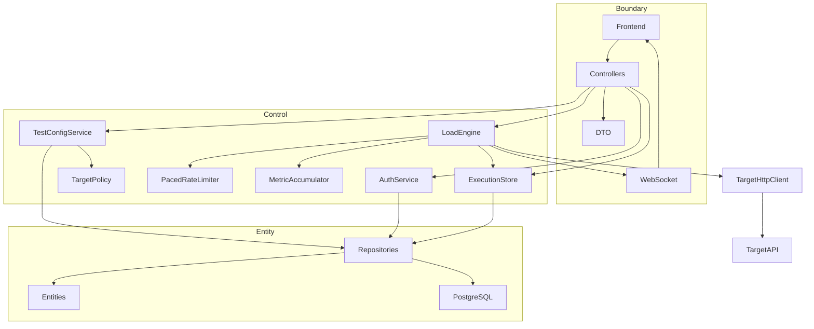
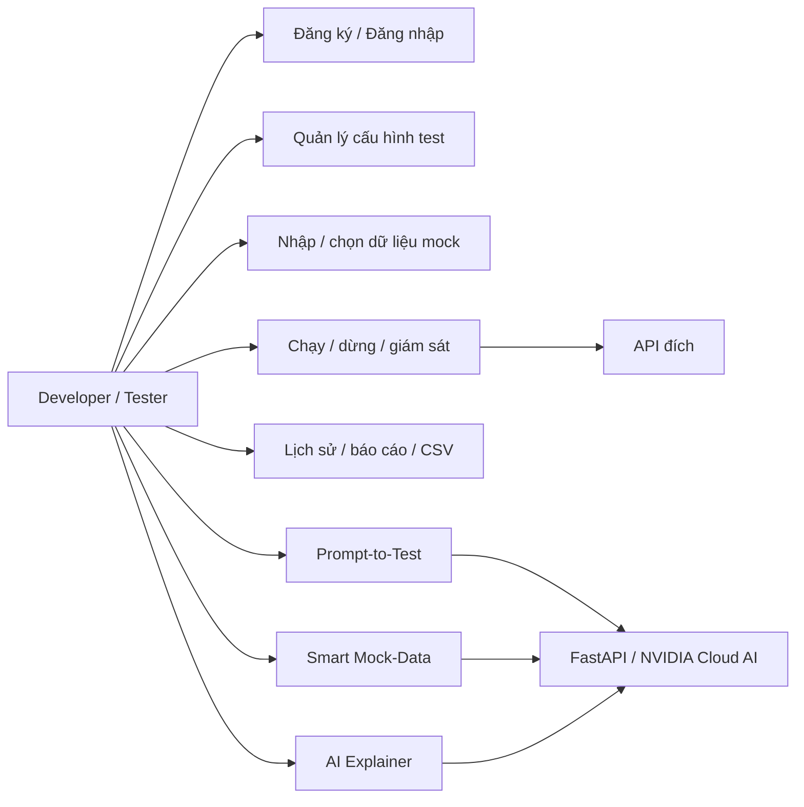
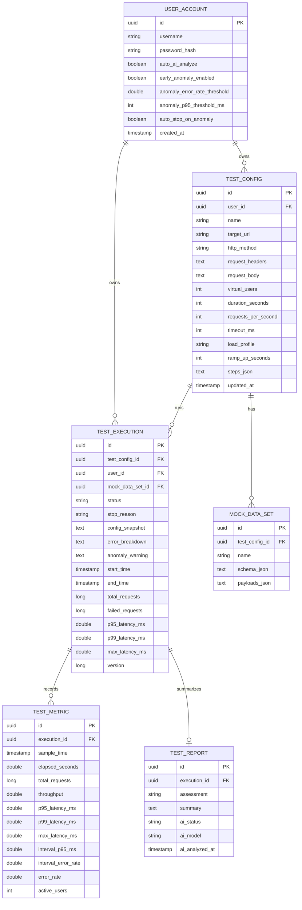
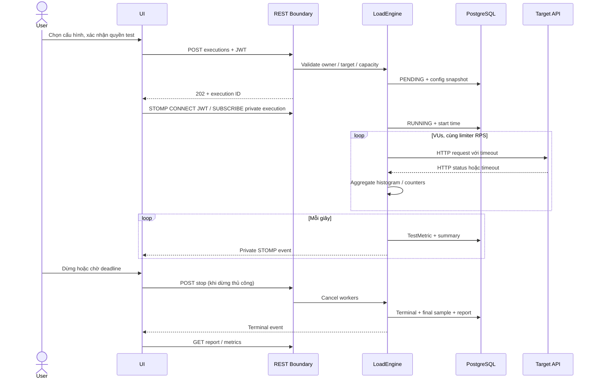
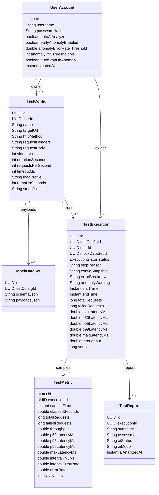

# Thiết kế hệ thống LoadSense

## 1. Phạm vi và nguyên tắc

Thiết kế theo đề cương nhóm 6: web app kiểm thử Web API, mô hình BCE, Java/Spring Boot, PostgreSQL, HTML/JavaScript (React) + Chart.js, FastAPI/Pydantic + **API LLM bên thứ ba tương thích chuẩn OpenAI** (mặc định **NVIDIA Cloud AI**, cấu hình qua `LLM_*` / `NVIDIA_*`). Phương án Local LLM/Ollama đã bị loại bỏ theo quyết định triển khai. Toàn bộ các luồng kiểm thử thủ công, Load/Stress/Spike profiles, Scenario Chaining tối giản (0–3 bước), Early Anomaly Detection theo nhịp đo, User Settings (`/api/settings`), Auto AI Explainer (kèm `bottlenecks` & `recommendations`), Prompt-to-Test và Smart Mock-Data đã được triển khai.

Frontend không tự tạo tải, không gọi PostgreSQL hoặc FastAPI. Core là điểm kiểm tra URL, tải, quyền sở hữu và vòng đời. React là lớp tổ chức giao diện JavaScript, giữ lựa chọn của skeleton.

## 2. BCE và sơ đồ gói

| Lớp | Gói / thành phần | Trách nhiệm |
| --- | --- | --- |
| Boundary | Frontend, `controller`, `dto`, `RateLimiter` | Nhập liệu, validation hình thức, giới hạn tốc độ gọi AI (`ai-rate-limit-per-minute`), REST status, hiển thị và xuất dữ liệu |
| Boundary | `config.WebSocketConfig` | Xác thực CONNECT và kiểm tra quyền SUBSCRIBE; chặn SEND từ client |
| Control | `AuthService` | BCrypt, cấp JWT, chống brute-force đăng nhập (5 lần sai/60s → 429) và cài đặt người dùng (`GET/PUT /api/settings`) |
| Control | `TestConfigService`, `TargetPolicy` | CRUD, JSON/headers/target, Scenario Chaining (0–3 bước, chặn `{{var}}` ở scheme/authority), kiểm định JSON Schema |
| Control | `LoadEngine`, `PacedRateLimiter` | Admission limit, `LoadProfile` (`CONSTANT`, `RAMP_UP`, `STEP_STRESS`, `SPIKE`), thực thi chuỗi bước cô lập, Early Anomaly Detection, bounded AI pool (`ThreadPoolExecutor(2..4)`), `stopReason` |
| Control | `MetricAccumulator`, `ExecutionStore` | Histogram kép (cumulative + 1s window: `p99`, `max`, `intervalP95Ms`, `intervalErrorRate`), `errorBreakdown`, persistence, snapshot/report và recovery |
| Adapter | `client.TargetHttpClient` | HTTP có timeout, không redirect, không cookie jar dùng chung (`disableCookieManagement`), giới hạn đọc body 64 KiB khi trích xuất biến |
| Adapter | `client.AiClient` | Gọi FastAPI AI Service, map 401/403 từ AI Service sang `503 AI_AUTH_ERROR` |
| Entity | `entity`, `repository` | Dữ liệu bền vững (Flyway V1–V6) và truy vấn theo tài khoản |
| AI boundary | FastAPI + Pydantic + 3rd-Party LLM API | Contract JSON Schema, `detect_bottlenecks_and_recommendations`, lọc số liệu ungrounded và retry/backoff `429/502/503/504` |

## 3. Tác nhân và Use Case

### UC-01: Đăng ký / đăng nhập

Người dùng nhập username (3–40 ký tự chữ/số/dấu `_.-`) và mật khẩu (8–72 ký tự, tối đa 72 byte UTF-8 theo BCrypt). Đăng ký kiểm tra unique; mật khẩu chỉ lưu hash. `AuthService` khóa tạm thời 60 giây (`429 LOGIN_RATE_LIMITED`) nếu đăng nhập sai liên tiếp 5 lần trong 60 giây trên cùng một `username`. Đăng nhập thành công trả JWT HS256, issuer `loadsense`, UUID user ở subject, hết hạn sau 24 giờ. Frontend giữ session trong sessionStorage, logout xóa session. Token sai/hết hạn bị chặn; lỗi 401 đưa giao diện về đăng nhập.

### UC-02: Tạo và quản lý cấu hình

Tiền điều kiện: đã đăng nhập. Nhập tên, URL, method, headers JSON, body, VUs, duration, RPS, timeout, cùng kiểu tải **`loadProfile`** (`CONSTANT`, `RAMP_UP`, `STEP_STRESS`, `SPIKE`), `rampUpSeconds`, và tùy chọn **Scenario Chaining** (0–3 `ScenarioStep` tuần tự kèm trích xuất JSON path sang biến `{{var}}`). Boundary kiểm tra DTO; `TargetPolicy` kiểm tra allowlist cho mọi URL trong chain, chặn `{{...}}` trong scheme/authority để phòng SSRF template injection, và kiểm tra URI, body/headers. Sau khi lưu, cấu hình có thể sửa hoặc tái sử dụng. Chỉ xóa cấu hình chưa có execution; khi có lịch sử trả 409 để giữ liên kết và báo cáo. Không cho người khác đọc/sửa/xóa qua ID.

### UC-03: Mock data thủ công & Smart Mock-Data

Method có body được thêm bộ payloads, 1–1000 JSON object, payload input ≤256 KiB, schema ≤64 KiB và mỗi payload ≤64 KiB. Khi có `schemaJson`, Core kiểm định từng payload theo JSON Schema trước khi lưu. Có thể sinh payload từ schema bằng NVIDIA Cloud AI (`/api/ai/generate-mockdata`) để xem trước và duyệt trước khi lưu. Khi chạy, chọn bộ dữ liệu cùng cấu hình (`mockDataSetId` được lưu vết trên `TestExecution`); engine đọc toàn bộ một lần rồi xoay vòng theo số thứ tự request.

### UC-04: Execution & Monitoring

Tiền điều kiện: cấu hình hợp lệ thuộc user, user xác nhận quyền test (bao gồm mọi host xuất hiện trong Scenario Chaining), còn admission slot. Core revalidate target và mock dataset, lưu execution PENDING cùng snapshot bất biến. Coordinator chuyển RUNNING, chạy VUs với `PacedRateLimiter` theo `loadProfile` (`CONSTANT`, `RAMP_UP`, `STEP_STRESS`, `SPIKE`). Nếu có `steps`, `executeChain` chạy tuần tự trong phạm vi riêng của từng iteration, trích xuất biến JSON (từ body tối đa 64 KiB) và thay thế an toàn CRLF sang các bước tiếp theo. Mỗi giây lưu một `TestMetric` kèm `p99LatencyMs`, `maxLatencyMs`, `intervalP95Ms`, `intervalErrorRate`, cập nhật `errorBreakdown` (`http4xx`, `http429`, `http5xx`, `timeout`, `network`) và phát private user destination.

Trong vòng lặp 1 giây, **Early Anomaly Detection** đánh giá dựa trên **chỉ số theo nhịp (`intervalErrorRate`, `intervalP95Ms`)** (bỏ qua nhịp rỗng và chờ `totalRequests >= 10`): khi vượt ngưỡng, engine ghi nhận `anomalyWarning` và phát qua STOMP. Nếu `autoStopOnAnomaly` bật và xảy ra 3 chu kỳ bất thường liên tiếp, engine tự động dừng bảo vệ với `stopReason = "ANOMALY"`. Các lý do kết thúc khác được phân biệt qua `stopReason`: `"COMPLETED"`, `"USER"`, `"INTERRUPTED"`, `"ERROR"`. Frontend subscribe theo execution, đồng thời REST incremental polling (`GET /api/executions/{id}/metrics?afterElapsed=...`) mỗi 2 giây để khôi phục khi WebSocket gián đoạn. Deadline hoặc stop kết thúc workers, ghi sample cuối, trạng thái và TestReport. Nếu `autoAiAnalyze` bật, Core đánh dấu `report.aiStatus = "PENDING"` và chạy **Auto AI Explainer** bất đồng bộ trên `ThreadPoolExecutor(2, 4, 60s, LinkedBlockingQueue(32))`. Dừng là idempotent; phản hồi stop có thể còn RUNNING trong khi coordinator cleanup.

Ngoại lệ: target timeout/network/HTTP 4xx–5xx được phân loại vào `errorBreakdown`, tính request lỗi và tiếp tục; lỗi engine/persistence chuyển FAILED nếu DB còn khả dụng. Không lưu raw lỗi có URL/header/body. Khi process chết, execution đang mở được đánh FAILED (`stopReason = "INTERRUPTED"`) khi restart. Không tự resume tải.

### UC-05: Lịch sử, báo cáo và đối chiếu

Trả 100 execution mới nhất thuộc user. Frontend lọc trạng thái và tên/URL; chọn execution để xem metrics đã lưu (`p50`, `p95`, `p99`, `Max`, `Interval p95`, `Error %` theo giây) và đối chiếu 2 lần chạy (**Baseline vs Current**). Report chỉ có sau terminal state. Đánh giá cố định theo ngưỡng mặc định hoặc phân tích AI (`PENDING` → `COMPLETED` / `INSUFFICIENT_DATA` / `FAILED`, kèm `ai_model` và `ai_analyzed_at`). CSV chứa đầy đủ các cột đo bao gồm `p99_latency_ms`, `max_latency_ms`, `interval_p95_ms`, `interval_error_rate` và timestamp, không chứa credentials hoặc body. Snapshot lịch sử không bị thay đổi khi cấu hình nguồn được sửa.

### UC-AI: Prompt-to-Test / Smart Mock-Data / AI Explainer

Core `/api/ai/*` và `/api/executions/{id}/report/ai` áp dụng giới hạn tốc độ theo user (**10 lượt/phút/user** qua `RateLimiter`, trả `429 AI_RATE_LIMITED` khi vượt ngưỡng) trước khi gọi FastAPI AI Service. AI Service sử dụng **API LLM bên thứ ba tương thích chuẩn OpenAI** (mặc định **NVIDIA Cloud AI — NVIDIA Nemotron**, cấu hình qua `LLM_*` hoặc fallback `NVIDIA_*`) với `response_format` JSON Schema và cơ chế retry/exponential backoff (tối đa 3 lần) cho HTTP `429/502/503/504`. `AiClient` map lỗi `401`/`403` từ AI Service sang `503 AI_AUTH_ERROR` để tránh đăng xuất nhầm người dùng ở frontend. Với `/analyze-log`, hàm `detect_bottlenecks_and_recommendations` phân tích deterministic theo số liệu thực (`http429`, `http5xx`, `timeout`/`network`, `http4xx`, độ trễ tăng giữa nửa đầu/sau hoặc đỉnh `intervalP95Ms`, đuôi `p99`, bão hòa throughput, `stopReason = ANOMALY`) để luôn xuất đầy đủ `bottlenecks`, `recommendations` cùng `findings`, đồng thời lọc câu chứa số liệu không có trong đầu vào qua `_contains_digits`. Khi có dưới 10 request hoặc thiếu dữ liệu xu hướng sẽ trả `INSUFFICIENT_DATA`.

## 4. Entity và quan hệ

Entity được ánh xạ JPA qua UUID FK; không serialize quan hệ lazy hoặc password hash ra API. Response DTO của execution bỏ `config_snapshot` (có thể chứa header riêng) và bổ sung `mockDataSetId`, `errorBreakdown`, `anomalyWarning`, `stopReason`, `p99LatencyMs`, `maxLatencyMs`. Các metric còn có `average`, `p50`/`p95`/`p99`/`max`, `intervalP95Ms`, `intervalErrorRate`, `failedRequests`. Report unique execution. Index user/time, config và execution/sample hỗ trợ history/realtime. Flyway gồm V1 (skeleton), V2 (mở rộng bảng và backfill `user_id`), V3/V4 (bổ sung chỉ mục/cột AI), **V5 (`V5__settings_anomaly_and_traceability.sql`)** thêm cài đặt người dùng và traceability, và **V6 (`V6__interval_metrics_load_profile_and_stop_reason.sql`)** bổ sung `load_profile`, `ramp_up_seconds`, `steps_json`, `p99_latency_ms`, `max_latency_ms`, `interval_p95_ms`, `interval_error_rate` và `stop_reason`.

## 5. Trình tự thực thi

## 6. Đa luồng, số liệu và độ trễ

Mỗi execution có một coordinator và fixed thread pool bằng số VUs (tối đa 300). Số coordinator bị giới hạn (`MAX_ACTIVE_EXECUTIONS`, mặc định 2, cho phép 1–4). Shared Java HttpClient dùng pool I/O riêng 16 threads, HTTP/1.1, connect timeout 5s, followRedirects NEVER. Request timeout là nhỏ hơn giữa timeout cấu hình và thời gian còn lại. Không queue execution khi hết slot: trả 409.

Limiter cấp thời điểm bắt đầu request theo `effectiveRps(elapsedSeconds)` của `loadProfile` (`CONSTANT`, `RAMP_UP`, `STEP_STRESS`, `SPIKE`), dùng monotonic clock; các VU dùng chung limiter, tránh nhân RPS theo số worker. Các VU chờ slot kiểm tra stop/interruption mỗi tối đa 20ms. Đến deadline, interrupt request đang chờ; request bị hủy bởi stop không được tính là response hoàn tất. Worker cleanup chờ tối đa 5s; shutdown app chờ coordinator tối đa 10s.

Mỗi execution duy trì **song song 2 histogram** cố định 30.001 bucket (độ phân giải 1ms, bounded memory): `cumulativeHistogram` tính `p50`/`p95`/`p99`/`max` tích lũy từ đầu execution, và `windowHistogram` được reset mỗi 1 giây khi `sample()` để tính `intervalP95Ms` và `intervalErrorRate` tức thời. Throughput mỗi metric là số request hoàn tất trong khoảng đo / khoảng thời gian; throughput cuối execution là trung bình toàn phiên. Latency là toàn bộ thao tác HTTP đến khi response body được đọc/hủy, gồm network/waiting, không chỉ server processing. HTTP 2xx–3xx tính thành công; redirect 3xx không được theo. Error là network/timeout và HTTP ngoài 200–399.

Một metric mỗi giây thay cho insert từng request; sample cuối có thể ngắn hơn 1s. Frontend nhận WebSocket, incremental polling (`afterElapsed`) mỗi 2s làm dự phòng và phục hồi mẫu thiếu theo UUID. Đã kiểm chứng benchmark thực tế với `scripts/benchmark.mjs` ở 50/100/300 VUs (đạt ~495–499 req/s với `RPS_LIMIT=500`, độ trễ STOMP `p95UpdateMs = 16–27 ms << 2000 ms`).

## 7. Ràng buộc và vận hành

- HTTP/HTTPS, exact host allowlist, không wildcard, không userinfo/fragment, không redirect, port hợp lệ.
- Giới hạn headers 32/16KiB, body 64KiB, không Host/Connection/Content-Length/Upgrade/Expect/Transfer-Encoding hoặc CRLF.
- REST mọi cấu hình/execution/dataset/report/CSV kiểm tra UUID owner. STOMP CONNECT decode JWT; SUBSCRIBE revalidate JWT và kiểm tra execution owner; không cho topic chung hoặc client SEND.
- Các allowed host là cấu hình tin cậy của người vận hành. Chưa có DNS pinning/kiểm soát IP sau DNS; chỉ thêm hostname do bạn kiểm soát và dùng firewall/egress policy cho deployment có nhiều người dùng.
- Header/body có thể chứa credentials, được lưu để thực thi nhưng không đưa vào metric/report/CSV/log; cần bảo vệ DB, TLS và secret riêng khi triển khai ngoài dev.
- Một Core instance duy nhất. Recovery đánh FAILED các execution đang mở; không triển khai distributed worker, lock nhiều instance hoặc load balancing STOMP broker.
- Demo endpoint chỉ phục vụ thử luồng, không dùng để đánh giá độc lập throughput engine (chung JVM); tắt trước khi triển khai ngoài demo.

## 8. Tài liệu kỹ thuật đối chiếu

- [Spring Framework: STOMP token authentication](https://docs.spring.io/spring-framework/reference/6.2/web/websocket/stomp/authentication-token-based.html): ChannelInterceptor xác thực STOMP CONNECT và gắn Principal.
- [Spring Security: JWT resource server](https://docs.spring.io/spring-security/reference/servlet/oauth2/resource-server/jwt.html): JWT decoder, issuer validator và Bearer authentication.

## 9. Sơ đồ lớp Entity (thuộc tính chính)

Sơ đồ thể hiện quan hệ nghiệp vụ. Hiện thực dùng UUID foreign key và repository queries để tránh serialize entity graph hoặc truy vấn lazy ngoài transaction; DTO quyết định chính xác dữ liệu được đưa qua Boundary.
