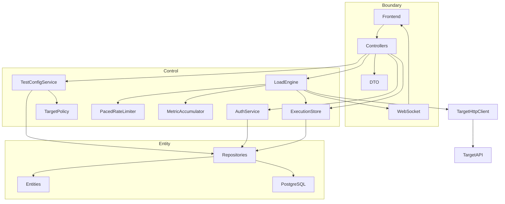
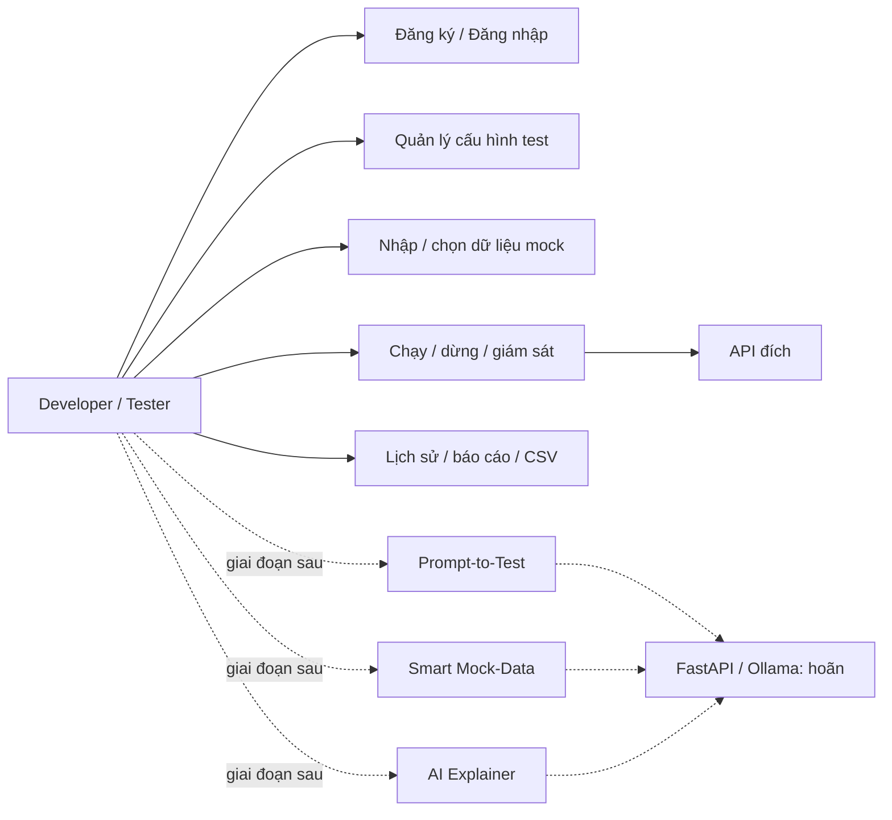
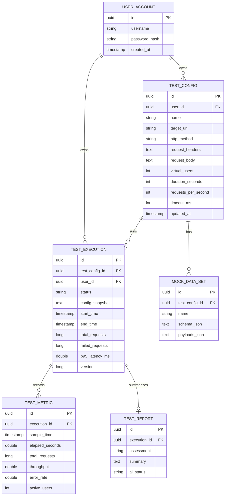
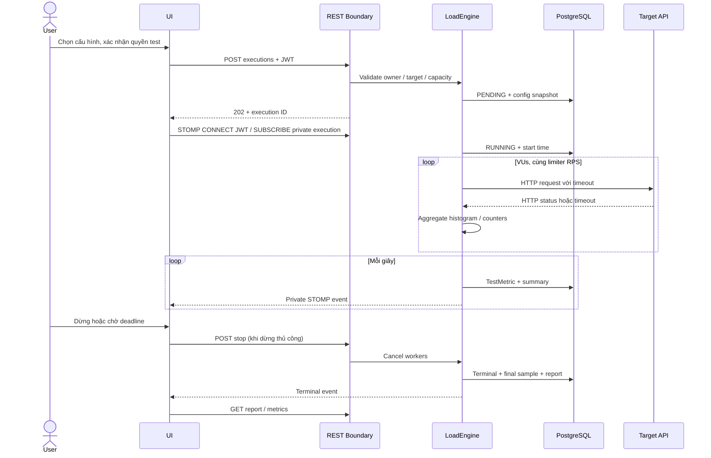
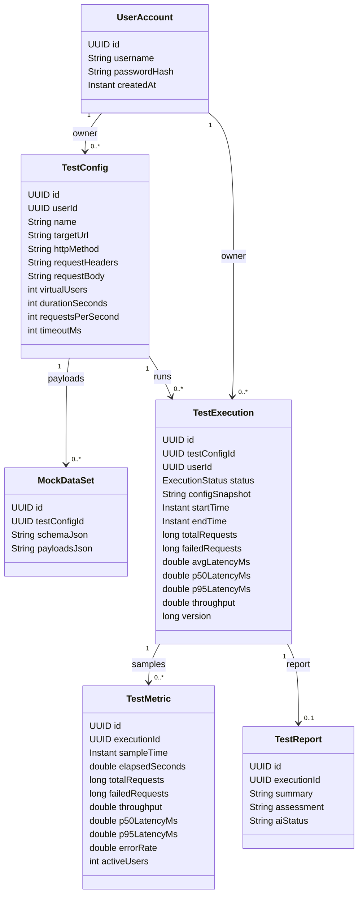

# Thiết kế hệ thống LoadSense

## 1. Phạm vi và nguyên tắc

Thiết kế theo đề cương nhóm 6: web app kiểm thử Web API, mô hình BCE, Java/Spring Boot, PostgreSQL, HTML/JavaScript/Chart.js, FastAPI/Pydantic cho lớp AI. LocalAI hoãn theo yêu cầu hiện tại. Tính năng đã triển khai là luồng kiểm thử thủ công có lưu trữ và realtime; ba ca sử dụng AI có contract và giao diện biểu thị trạng thái chưa bật.

Frontend không tự tạo tải, không gọi PostgreSQL hoặc FastAPI. Core là điểm kiểm tra URL, tải, quyền sở hữu và vòng đời. React là lớp tổ chức giao diện JavaScript, giữ lựa chọn của skeleton.

## 2. BCE và sơ đồ gói

| Lớp | Gói / thành phần | Trách nhiệm |
| --- | --- | --- |
| Boundary | Frontend, `controller`, `dto` | Nhập liệu, validation hình thức, REST status, hiển thị và xuất dữ liệu |
| Boundary | `config.WebSocketConfig` | Xác thực CONNECT và kiểm tra quyền SUBSCRIBE; chặn SEND từ client |
| Control | `AuthService` | BCrypt và cấp JWT |
| Control | `TestConfigService`, `TargetPolicy` | CRUD, JSON/headers/target, dữ liệu mock thủ công |
| Control | `LoadEngine`, `PacedRateLimiter` | Admission limit, điều phối VUs, deadline, stop, cleanup |
| Control | `MetricAccumulator`, `ExecutionStore` | Histogram, sample, persistence, snapshot/report và recovery |
| Adapter | `client.TargetHttpClient` | HTTP có timeout, không redirect, không log nội dung request |
| Entity | `entity`, `repository` | Dữ liệu bền vững và truy vấn theo tài khoản |
| AI boundary | FastAPI + Pydantic | Các request/response contract; 501 khi gọi, chưa có Ollama client |

## 3. Tác nhân và Use Case

### UC-01: Đăng ký / đăng nhập

Người dùng nhập username (3–40 ký tự chữ/số/dấu `_.-`) và mật khẩu (8–72 ký tự, tối đa 72 byte UTF-8 theo BCrypt). Đăng ký kiểm tra unique; mật khẩu chỉ lưu hash. Đăng nhập thành công trả JWT HS256, issuer `loadsense`, UUID user ở subject, hết hạn sau 24 giờ. Frontend giữ session trong sessionStorage, logout xóa session. Token sai/hết hạn bị chặn; lỗi 401 đưa giao diện về đăng nhập.

### UC-02: Tạo và quản lý cấu hình

Tiền điều kiện: đã đăng nhập. Nhập tên, URL, method, headers JSON, body, VUs, duration, RPS, timeout. Boundary kiểm tra DTO; Control kiểm tra allowlist, URI, body/headers. Sau khi lưu, cấu hình có thể sửa hoặc tái sử dụng. Chỉ xóa cấu hình chưa có execution; khi có lịch sử trả 409 để giữ liên kết và báo cáo. Không cho người khác đọc/sửa/xóa qua ID.

### UC-03: Mock data thủ công / Smart Mock-Data tương lai

Hiện tại: method có body được thêm bộ payloads, 1–1000 JSON object, payload input ≤256 KiB, schema ≤64 KiB và mỗi payload ≤64 KiB. Schema JSON object tùy chọn được lưu tham chiếu, chưa validate theo schema. Khi chạy, chọn bộ dữ liệu cùng cấu hình; engine đọc toàn bộ một lần rồi xoay vòng theo số thứ tự request. Không có dữ liệu từ model. Tương lai: FastAPI nhận schema/count, trả payloads; Core kiểm định lại và người dùng duyệt trước khi lưu.

### UC-04: Execution & Monitoring

Tiền điều kiện: cấu hình hợp lệ thuộc user, user xác nhận quyền test, còn admission slot. Core revalidate target và mock dataset, lưu execution PENDING cùng snapshot bất biến. Coordinator chuyển RUNNING, chạy VUs với limiter chung. Mỗi giây lưu một TestMetric và phát private user destination. Frontend subscribe theo execution, đồng thời REST polling mỗi 2 giây để khôi phục khi WebSocket gián đoạn. Deadline hoặc stop kết thúc workers, ghi sample cuối, trạng thái và TestReport. Dừng là idempotent; phản hồi stop có thể còn RUNNING trong khi coordinator cleanup.

Ngoại lệ: target timeout/network/HTTP 4xx–5xx được tính request lỗi và tiếp tục; lỗi engine/persistence chuyển FAILED nếu DB còn khả dụng. Không lưu raw lỗi có URL/header/body. Khi process chết, execution đang mở được đánh FAILED khi restart. Không tự resume tải.

### UC-05: Lịch sử và báo cáo

Trả 100 execution mới nhất thuộc user. Frontend lọc trạng thái và tên/URL; chọn execution để xem metrics đã lưu. Report chỉ có sau terminal state. Đánh giá cố định `errorRate ≥ 5%` hoặc `p95 ≥ 1000 ms`; không suy luận nguyên nhân. CSV chỉ chứa cột đo và timestamp, không chứa credentials hoặc body. Snapshot lịch sử không bị thay đổi khi cấu hình nguồn được sửa.

### UC-AI: Prompt-to-Test / AI Explainer

UI dành cho prompt được chuẩn bị, nút gửi disabled và giải thích rõ. Core `/api/ai/*` cùng FastAPI trả 501. Các Pydantic response quy định cấu hình đề xuất, warnings, payloads, summary/bottlenecks/recommendations. Chưa chạy Ollama, ép JSON model output, keep-alive hay phân tích log. Đây là công việc cho giai đoạn sau, không phải chức năng hoàn thành.

## 4. Entity và quan hệ

Entity được ánh xạ JPA qua UUID FK; không serialize quan hệ lazy hoặc password hash ra API. Response DTO của execution bỏ `config_snapshot` (có thể chứa header riêng). Các metric còn có average, p50/p95, failedRequests. Report unique execution. Index user/time, config và execution/sample hỗ trợ history/realtime. V1 giữ nguyên migration skeleton; V2 mở rộng đầy đủ và backfill user_id của execution cũ.

## 5. Trình tự thực thi

## 6. Đa luồng, số liệu và độ trễ

Mỗi execution có một coordinator và fixed thread pool bằng số VUs (tối đa 300). Số coordinator bị giới hạn (`MAX_ACTIVE_EXECUTIONS`, mặc định 2, cho phép 1–4). Shared Java HttpClient dùng pool I/O riêng 16 threads, HTTP/1.1, connect timeout 5s, followRedirects NEVER. Request timeout là nhỏ hơn giữa timeout cấu hình và thời gian còn lại. Không queue execution khi hết slot: trả 409.

Limiter cấp thời điểm bắt đầu request cách nhau `1s / RPS`, dùng monotonic clock; các VU dùng chung limiter, tránh nhân RPS theo số worker. Các VU chờ slot kiểm tra stop/interruption mỗi tối đa 20ms. Đến deadline, interrupt request đang chờ; request bị hủy bởi stop không được tính là response hoàn tất. Worker cleanup chờ tối đa 5s; shutdown app chờ coordinator tối đa 10s.

Histogram 30.001 bucket, độ phân giải 1ms, bounded memory khoảng 240KiB/execution. p50/p95, average và errorRate là tích lũy từ đầu execution. Throughput mỗi metric là số request hoàn tất trong khoảng đo / khoảng thời gian; throughput cuối execution là trung bình toàn phiên. Latency là toàn bộ thao tác HTTP đến khi response body được discard, gồm network/waiting, không chỉ server processing. HTTP 2xx–3xx tính thành công; redirect 3xx không được theo. Error là network/timeout và HTTP ngoài 200–399.

Một metric mỗi giây thay cho insert từng request; sample cuối có thể ngắn hơn 1s. Frontend nhận WebSocket, polling 2s làm dự phòng và phục hồi mẫu thiếu theo UUID. Ngưỡng UI trễ 1–2s là mục tiêu trong môi trường demo, cần benchmark target/hardware thực tế trước khi khẳng định SLA.

## 7. Ràng buộc và vận hành

- HTTP/HTTPS, exact host allowlist, không wildcard, không userinfo/fragment, không redirect, port hợp lệ.
- Giới hạn headers 32/16KiB, body 64KiB, không Host/Connection/Content-Length/Upgrade/Expect/Transfer-Encoding hoặc CRLF.
- REST mọi cấu hình/execution/dataset/report/CSV kiểm tra UUID owner. STOMP CONNECT decode JWT; SUBSCRIBE revalidate JWT và kiểm tra execution owner; không cho topic chung hoặc client SEND.
- Các allowed host là cấu hình tin cậy của người vận hành. Chưa có DNS pinning/kiểm soát IP sau DNS; chỉ thêm hostname do bạn kiểm soát và dùng firewall/egress policy cho deployment có nhiều người dùng.
- Header/body có thể chứa credentials, được lưu để thực thi nhưng không đưa vào metric/report/CSV/log; cần bảo vệ DB, TLS và secret riêng khi triển khai ngoài dev.
- Một Core instance duy nhất. Recovery đánh FAILED các execution đang mở; không triển khai distributed worker, lock nhiều instance hoặc load balancing STOMP broker.
- Demo endpoint chỉ phục vụ thử luồng, không dùng để đánh giá độc lập throughput engine (chung JVM); tắt trước khi triển khai ngoài demo.

## 8. Tài liệu kỹ thuật đối chiếu

- [Spring Framework: STOMP token authentication](https://docs.spring.io/spring-framework/reference/6.2/web/websocket/stomp/authentication-token-based.html): ChannelInterceptor xác thực STOMP CONNECT và gắn Principal.
- [Spring Security: JWT resource server](https://docs.spring.io/spring-security/reference/servlet/oauth2/resource-server/jwt.html): JWT decoder, issuer validator và Bearer authentication.

## 9. Sơ đồ lớp Entity (thuộc tính chính)

Sơ đồ thể hiện quan hệ nghiệp vụ. Hiện thực dùng UUID foreign key và repository queries để tránh serialize entity graph hoặc truy vấn lazy ngoài transaction; DTO quyết định chính xác dữ liệu được đưa qua Boundary.
